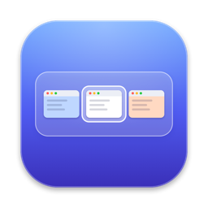
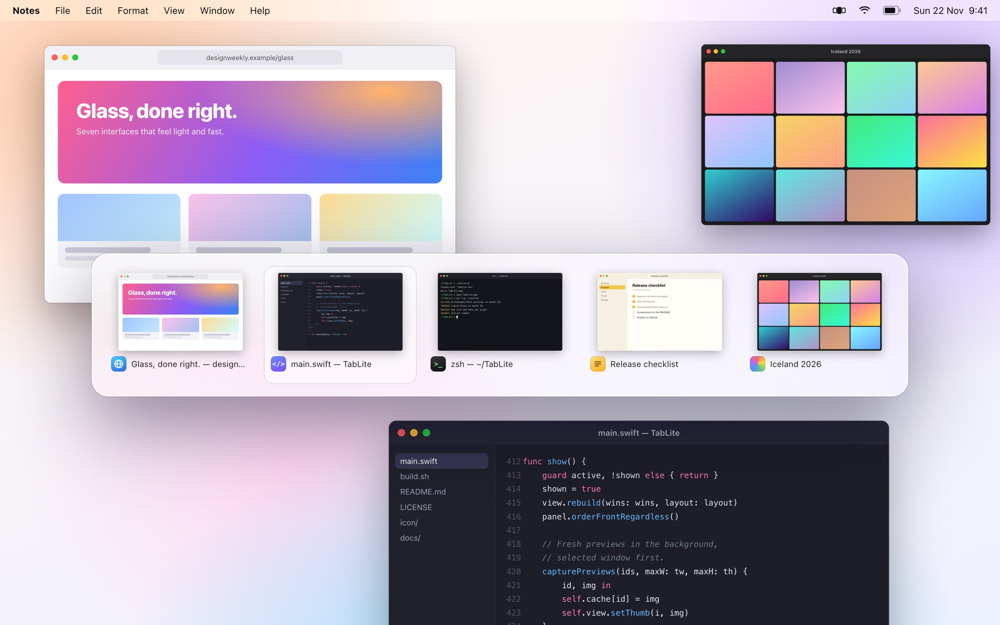

<p align="center">
  
</p>

<h1 align="center">TabLite</h1>

<p align="center">
  <b>A tiny, instant window switcher for macOS, with a live preview of every window.</b><br>
  One Swift file. No dependencies. Fast even on old Intel MacBooks.
</p>

<p align="center">
  <a href="https://github.com/Lucifix/TabLite/releases/latest"></a>
  
  
  
  
</p>

<p align="center">
  <picture>
    <source media="(prefers-color-scheme: dark)" srcset="assets/screenshot-dark.jpg">
    
  </picture>
  <br>
  <sub>Illustration</sub>
</p>

---

## Highlights

- **Instant.** The panel opens right away and never waits for screenshots. A quick tap switches without drawing anything.
- **Every window, not just every app.** Two browser windows are two tiles.
- **Live previews.** See what's in each window before you switch to it.
- **Glass that fits your Mac.** Liquid Glass on macOS 26 and frosted glass on older versions. Follows Light and Dark mode.
- **Featherweight.** No CPU use while idle: no polling, no timers, no background work.
- **Private.** No analytics, no accounts. The only network request is **Check for Updates**, and only when you choose it.

## Usage

| Keys | Action |
|---|---|
| Hold **⌥ Option** (or **⌘ Command**), press **Tab** | Open the switcher, then move to the next window |
| **⇧ Shift+Tab** &nbsp;/&nbsp; **← →** | Previous / next window |
| **↑ ↓** | Move between rows |
| Release **⌥ Option** / **⌘ Command** | Switch to the selected window |
| **Esc** | Cancel |
| Click a preview | Switch to that window |

A quick tap of the shortcut jumps straight back to your previous window.

### Multiple displays

The switcher opens on the display your mouse pointer is on. By default it lists windows from every display. To list only the windows on that display, turn on **Only show windows on the current display** in the TabLite menu bar icon. A window that spans two displays counts as being on the one that shows most of it.

### Option+Tab or Command+Tab

Pick your shortcut from the TabLite menu bar icon: **Switch with Option+Tab** (default) or **Switch with Command+Tab**.

With Command+Tab, TabLite replaces the macOS app switcher while it's running, and hands Command+Tab back to macOS when you switch back to Option+Tab, quit, or if TabLite crashes. After a Force Quit, the macOS switcher comes back when you open TabLite again or log out. Two things to know:

- It switches between **windows**, not apps.
- While you're typing in a **password field**, macOS hides keystrokes from all apps, so Command+Tab does nothing until you click elsewhere.

## Install

### Download

1. Download **`TabLite-x.y.z.zip`** from the [latest release](https://github.com/Lucifix/TabLite/releases/latest). It's universal (Intel + Apple Silicon).
2. Unzip it and move **TabLite.app** to your **Applications** folder.
3. Open it. The first time, macOS will warn that it can't verify the developer, because TabLite isn't notarized by Apple (that requires a paid Apple Developer account). To open it anyway:
   - **macOS 15 and later:** close the warning, go to **System Settings → Privacy & Security**, scroll down and click **Open Anyway** next to TabLite.
   - **macOS 14 and earlier:** Control-click **TabLite.app**, choose **Open**, then click **Open** again.

You only need to do this once. Prefer to check the code yourself? Build it from source instead.

### Build from source

You need the Xcode Command Line Tools (`xcode-select --install`).

```bash
git clone https://github.com/Lucifix/TabLite.git
cd TabLite
./build.sh
open TabLite.app
```

The build is universal (Intel + Apple Silicon). Move `TabLite.app` to `/Applications` to keep it.

### Permissions

On first launch, allow TabLite in **System Settings → Privacy & Security**:

| Permission | Why |
|---|---|
| **Accessibility** | Catch the shortcut and bring the chosen window to the front |
| **Screen Recording** | Window previews and titles. Without it, you get app icons and names |

Then choose **Restart TabLite** from its menu bar icon.

### Launch at Login

To have TabLite running whenever you start your Mac, choose **Launch at Login** from its menu bar icon. Keep the app in **Applications** first, since macOS remembers where it was when you turned this on.

### Updates

Choose **Check for Updates…** from the TabLite menu bar icon. TabLite asks GitHub for the latest release and, if there's a newer version, offers to install it: it downloads the release, checks it, replaces TabLite.app and restarts. It never checks on its own.

If the shortcut or previews stop working after an update, turn TabLite off and on again in **System Settings → Privacy & Security → Accessibility** and **Screen Recording**. Releases aren't signed with an Apple Developer certificate, so macOS may see each version as a new app.

## Why it's fast

- **Zero idle cost.** A single keyboard event tap; nothing runs until you press the shortcut.
- **One system call** builds the window list (~3 ms), in front-to-back order, which matches recent use.
- **The UI never waits.** The panel appears with cached previews. Fresh ones are captured in the background, selected window first, and swapped in as they arrive.
- **Small previews.** Previews are kept at tile size, not full resolution.
- **Warm start.** The one-time setup cost (~300 ms) is paid at launch, not the first time you switch.
- **GPU-friendly drawing.** Plain Core Animation layers with no animations. The glass is the system's own blur, rendered by macOS on the GPU.

## Compatibility

| macOS | Glass | Window previews | Status |
|---|---|---|---|
| 26 Tahoe and later | Liquid Glass | ScreenCaptureKit | Untested |
| 14 – 15 | Frosted glass | ScreenCaptureKit | Untested |
| 10.15 – 13 | Frosted glass | CGWindowListCreateImage | Tested on macOS 13 (Intel) |

On macOS 14 or later? Please [open an issue](https://github.com/Lucifix/TabLite/issues) and say whether it works for you, ideally with a screenshot.

## Development

<details>
<summary><b>Keep permissions across rebuilds</b></summary>

<br>

macOS ties permissions to the app's code signature. Without a certificate, every build gets a new signature and you must grant permissions again. Create a free self-signed certificate once:

1. Open **Keychain Access**, then in the menu bar choose **Keychain Access → Certificate Assistant → Create a Certificate…**
2. Name: `TabLite Dev` · Identity Type: **Self-Signed Root** · Certificate Type: **Code Signing** → **Create**

`build.sh` uses it automatically. Set `TABLITE_SIGN` to use a certificate with a different name.

</details>

<details>
<summary><b>Project layout</b></summary>

<br>

| Path | What |
|---|---|
| `main.swift` | The whole app |
| `build.sh` | Builds and signs `TabLite.app`. `./build.sh --zip` also packages `dist/TabLite-<version>.zip` for a release |
| `icon/make_icon.swift` | Draws the app icon in code. Regenerate with `swift icon/make_icon.swift` |
| `assets/` | Images used in this README |

`TabLite.app/Contents/MacOS/TabLite --list` prints the windows the switcher would show.

</details>

## Limitations

- Shows windows on the current Space only. Minimized windows aren't listed.
- Another app using the same shortcut will conflict with it.
- Taking over Command+Tab relies on a private macOS function. If a future macOS removes it, the Command+Tab option shows as unavailable and Option+Tab keeps working.

## License

[GPL-3.0](LICENSE)
